# GM tools

Tokens are the NPCs and monsters you put in the campaign world. You build them once as
templates, spawn as many copies as a scene needs, and then move, hide, reveal or play
them yourself.

## Templates

Templates live on the **NPCs** tab of your panel. Your computer keeps a copy of each one,
so you can build your library anywhere, even outside a campaign, and bring it to any
server you run games on.

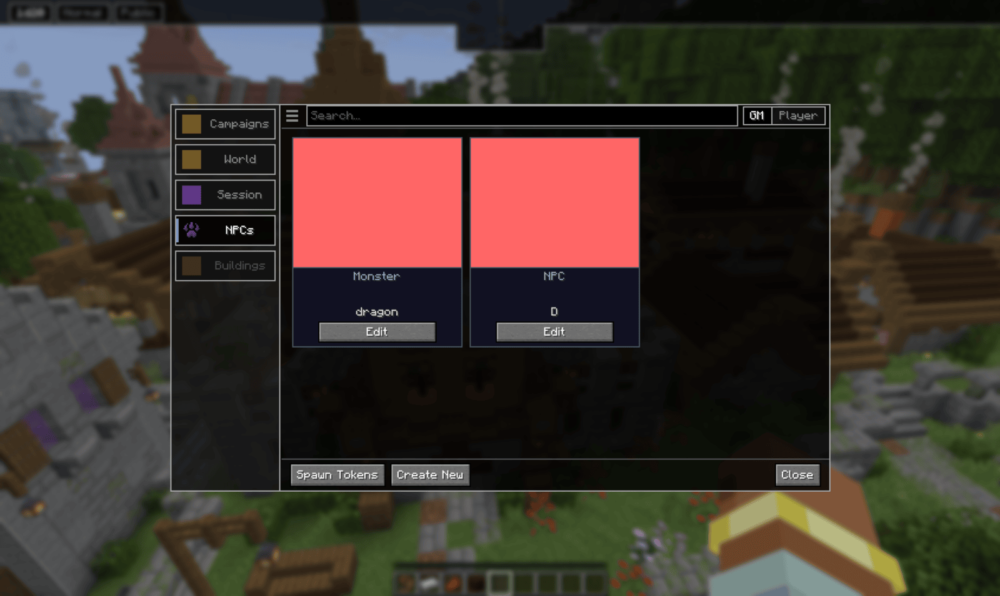

Each card says whether it is a monster or an NPC. **Edit** opens it, **Spawn Tokens**
opens the encounter screen, and **Create New** asks which kind to make.

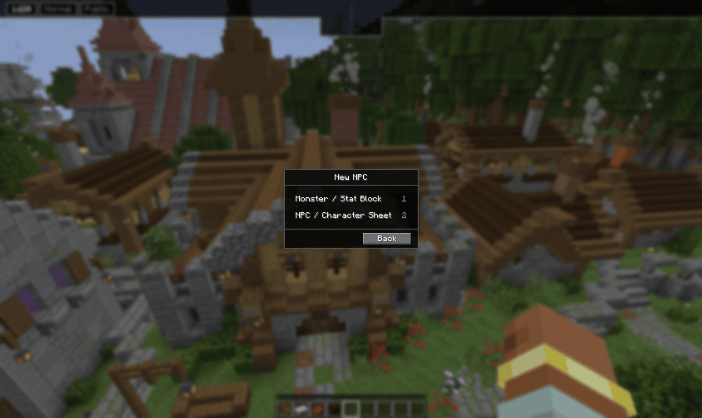

- **Monster / Stat Block** is a compact stat block: ability scores, AC, HP, speed,
  challenge rating, skills, saves, attacks and traits.
- **NPC / Character Sheet** is a full character sheet, the same one players use, with
  spells and a bio. Use it for an NPC who needs more depth than a stat block.

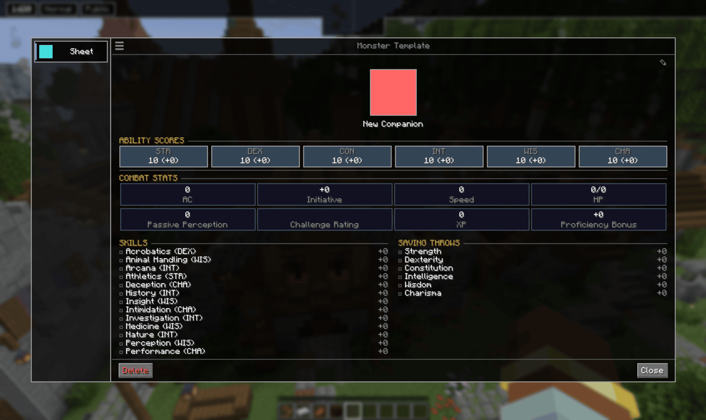

The **Details** section of a stat block switches on optional parts: spellcasting (which
adds a Spells page), bonus actions, reactions and mythic actions. Each one you tick adds
its own list to the sheet.

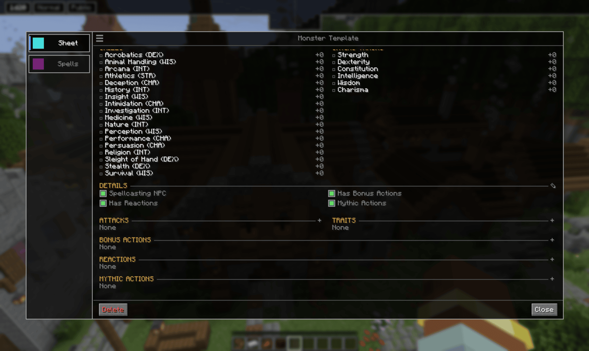

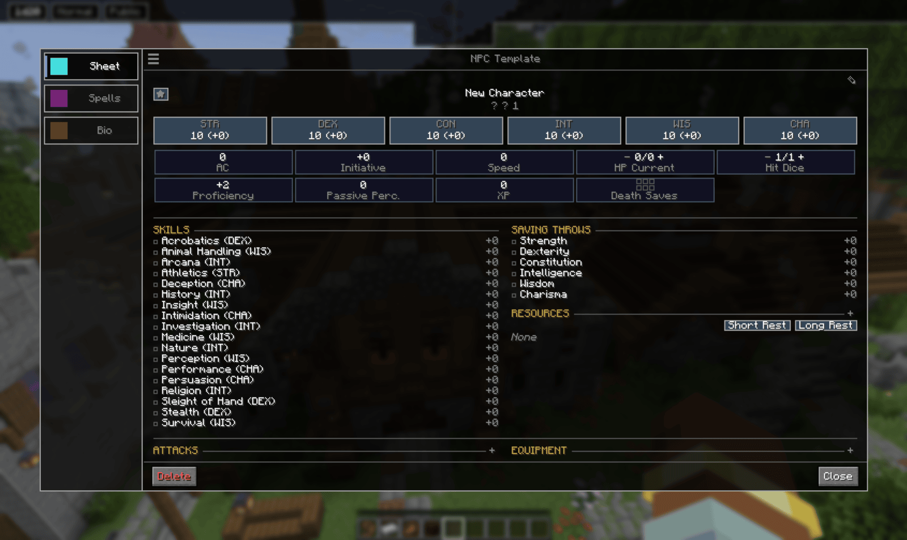

## Spawning tokens

You have to be inside the campaign world to spawn. Open the encounter screen from
**Spawn Tokens** on the NPCs tab or from the token wheel.

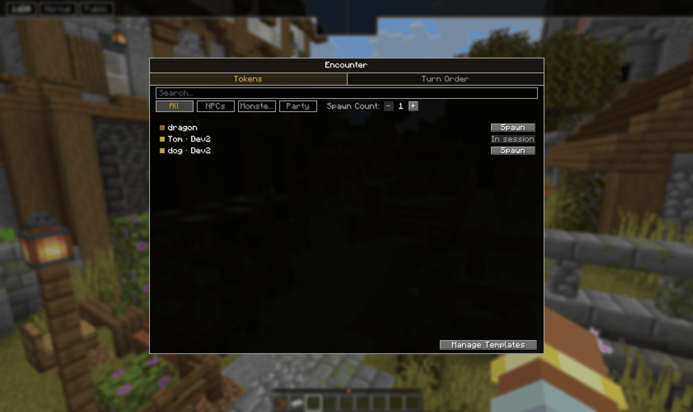

The **Tokens** tab lists your templates. Filter by **NPCs**, **Monsters** or **Party**, or
search by name. **Spawn Count** sets how many copies one click places, up to 8.
**Manage Templates** takes you back to the NPCs tab.

Click **Spawn** and the screen closes. A preview follows your crosshair. Press `V` to place
it there, or Escape to cancel. Several copies spread out around the spot. Each token gets a
number, `dragon #1`, `dragon #2`, and the count carries on across the campaign.

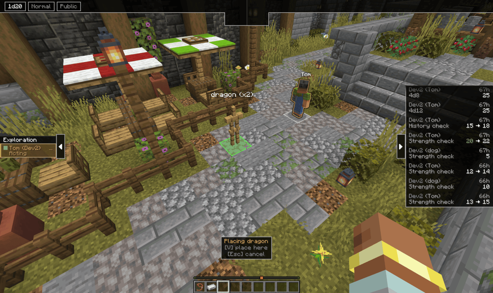

### Party tokens

The **Party** filter lists the characters and companions your players have synced into
the campaign. Spawning one places it as a token while its player is away, so the party can
stand complete on the board. When that player joins the session, they take over their
token. A character's row reads **In session** while its player is online, and **Placed**
once it has a token. Companions can be placed either way.

## Hidden tokens

**Every token spawns hidden.** You see it faded, with `(hidden)` after its name. Players
see nothing at all: no body, no name, and no entry in the turn order. Set the scene, then
reveal what the party can see.

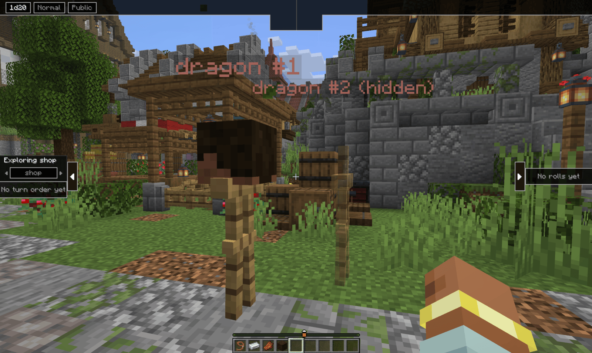

## The token menu

Right-click a token to open its menu. This works on spawned tokens and on players in the
session, including a ghosted player's body. Every row has a number key.

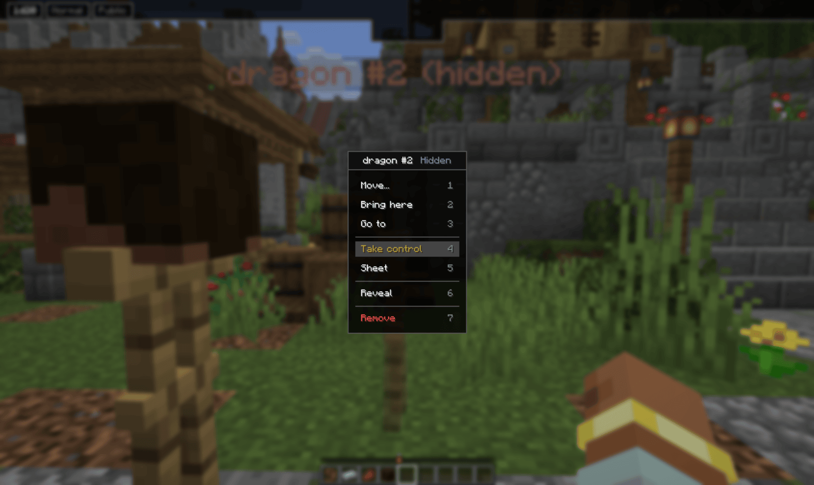

- **Move…** picks the token up. A preview follows your crosshair, `V` puts it down.
- **Bring here** moves the token to you, **Go to** moves you to the token.
- **Take control** lets you play the token yourself.
- **Sheet** opens the token's sheet.
- **Hide** / **Reveal** toggles whether players can see it. The header shows **Hidden**
  while it is hidden.
- **Remove** deletes the token, after asking.

### Token sheets

Spawning copies the template, so every token has its own sheet. Damage, used spells and
other changes stay on that token and never touch the template, or the other copies.

To keep a token's changes, turn on **Save token edits to template** in the campaign's
settings, under GM Tools. A token's sheet then has a **Save to template** button. Tokens
that belong to players never have it.

## Taking control

**Take control** puts you in the token's place. You are moved to where it stood, the token
disappears, and you walk in its place, with its name over your head. Your HUD shows
**Controlling:** and the token's name.

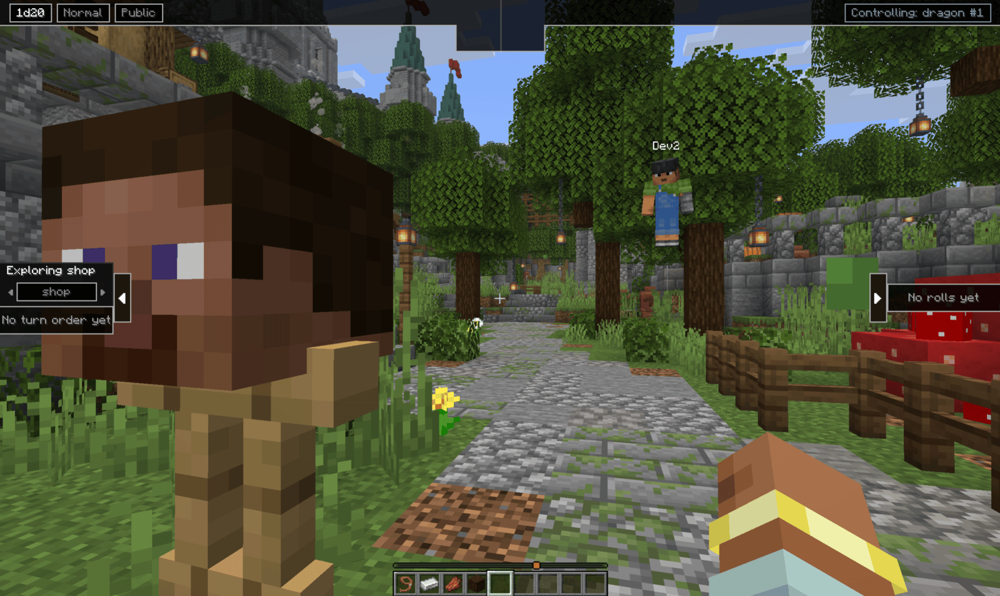

- Monsters and NPCs can be controlled any time, in or out of turn mode.
- A player's body can only be taken over in turn mode. The player is pushed into ghost
  mode and told that the GM has control.
- Controlling a hidden token keeps you invisible to players.

**Release Control** on your Me wheel, or `/voxelroll token release`, puts the token back
where you are standing.

## The token wheel

Hold `G` and go to **Tokens**.

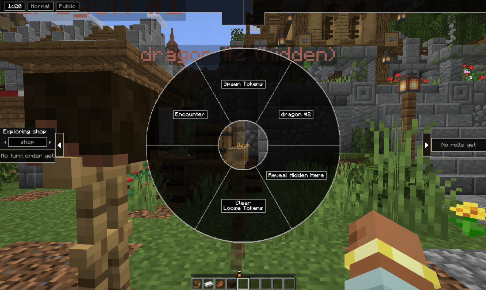

- **Spawn Tokens** and **Encounter** open the encounter screen on its Tokens or Turn Order
  tab.
- The token or player you are looking at gets its own slot, which opens its menu.
- **Reveal Hidden Here** reveals every hidden token in the moment you are standing in.
- **Clear Loose Tokens** removes every token that stands outside all moments, after
  asking. Party tokens are kept.

## Going unseen

The GM can turn invisible. Pick **Go Unseen** on your Me wheel, or press `H`. Players stop
seeing you, your name and what you hold, and your HUD shows **Unseen**. **Reappear**, or
`H` again, turns it off.

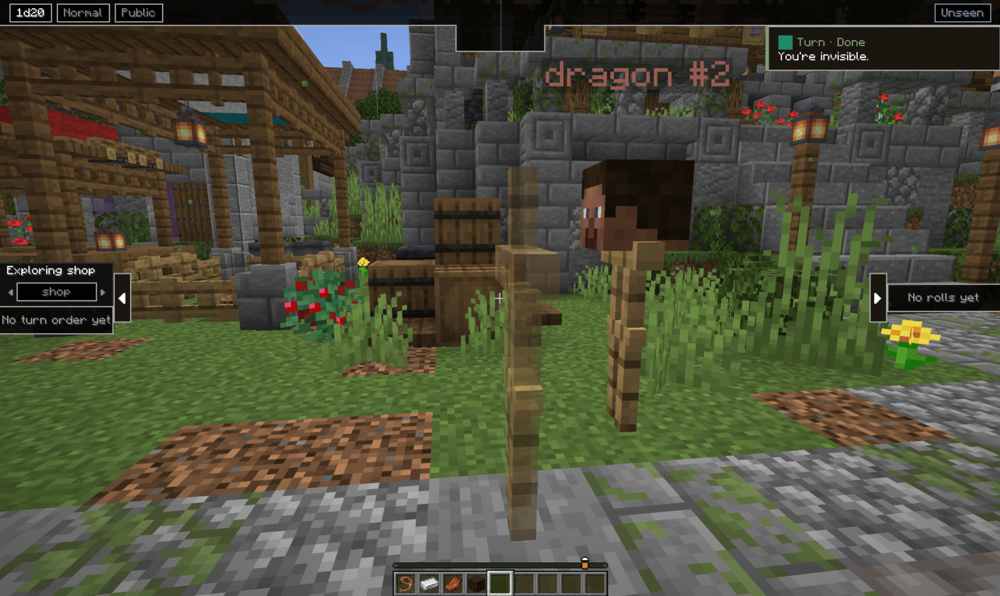

Full syntax for the token commands: [Command reference](../commands/#tokens)

[Back to the manual index](../)
