# Moments

A moment is a named area of the campaign world: the tavern, the library, the forest road.
You set them up ahead of time, then move the party between them during play. Moments are
also how you run a split party: each group sits in its own moment, and the **spotlight**
decides which one the table is watching.

## The Moments page

On the World tab, use the arrows at the bottom to switch to **Moments**.

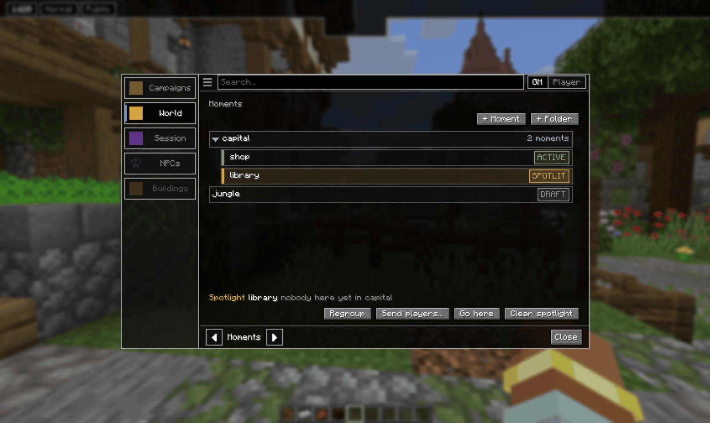

**+ Moment** and **+ Folder** add to the list. Folders nest up to four deep and keep a long
campaign tidy, one folder per town or chapter. The search bar filters by name.

Each moment carries a tag that says how far along it is:

| Tag | Means |
| --- | --- |
| **DRAFT** | No area yet. It cannot be used until you mark one. |
| **READY** | Has an area, not in use. |
| **ACTIVE** | Live: players are bound to it, or you activated it. Runs its own turn order. |
| **SPOTLIT** | The one the table is watching. Only one at a time. |

The line at the bottom names the spotlit moment and who is in it. Its buttons act on the
spotlit moment: **Regroup**, **Send players…**, **Go here** and **Clear spotlight**.

## Creating a moment

**+ Moment** asks for a name and creates the moment at the top level. To make one inside a
folder, use **New moment here** on that folder's menu.

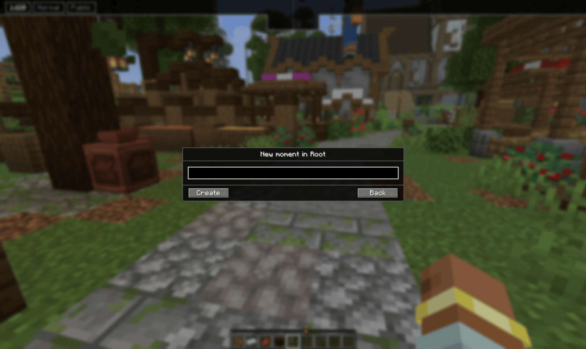

A new moment is a DRAFT. Click it to open its menu, where everything that needs an area is
greyed out until it has one.

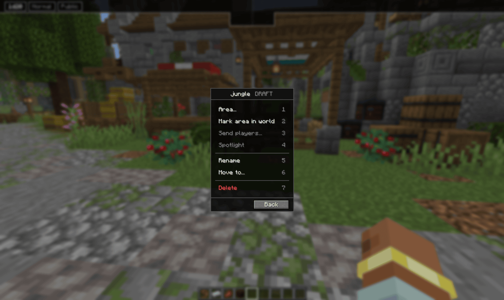

### Marking the area

**Mark area in world** hands you a wand. Left click a block for the first corner, right
click another for the second, and the box between them is outlined in the world. Press `V`
to apply, or Escape to cancel. You have to be inside the world for this.

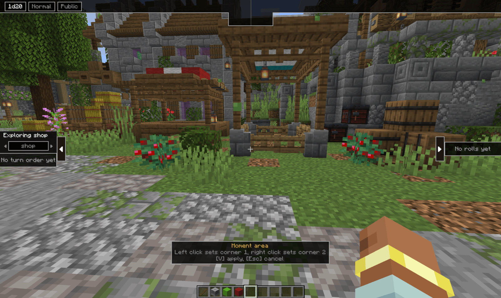

**Area…** shows the moment's area: its size, and whether it has a spawn point.

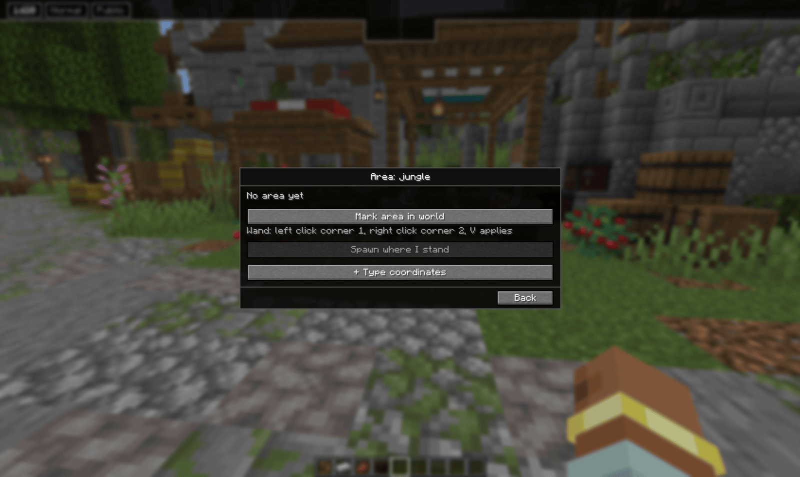

- **Spawn where I stand** sets where players arrive. If you never set one, an area marked
  with the wand uses the first corner you clicked.
- **+ Type coordinates** opens fields for both corners and the spawn, for when you would
  rather type numbers than click blocks. Leave the spawn fields empty and players arrive in
  the middle of the area.

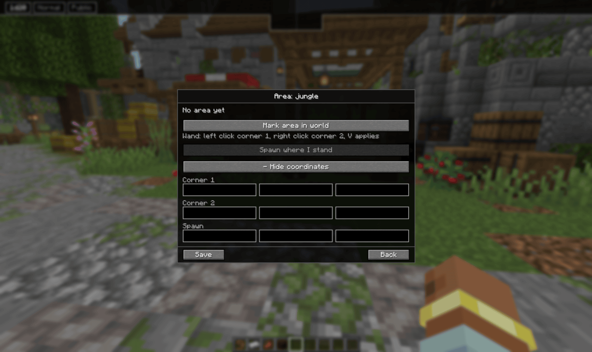

## Using a moment

Once a moment has an area, its menu fills out.

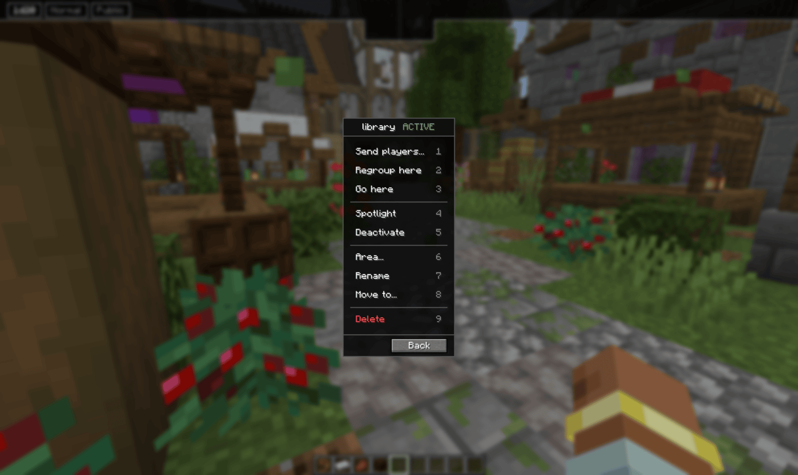

- **Send players…** picks who goes there.
- **Regroup here** sends the whole session there at once.
- **Go here** takes only you, without moving anyone else.
- **Spotlight** makes it the scene the table watches. See below.
- **Activate** / **Deactivate** turns it live or off. Sending players or spotlighting
  activates it for you. Deactivating releases everyone bound to it.
- **Rename**, **Move to…** and **Delete** manage it in the list. Deleting a folder moves its
  contents up one level instead of deleting them.

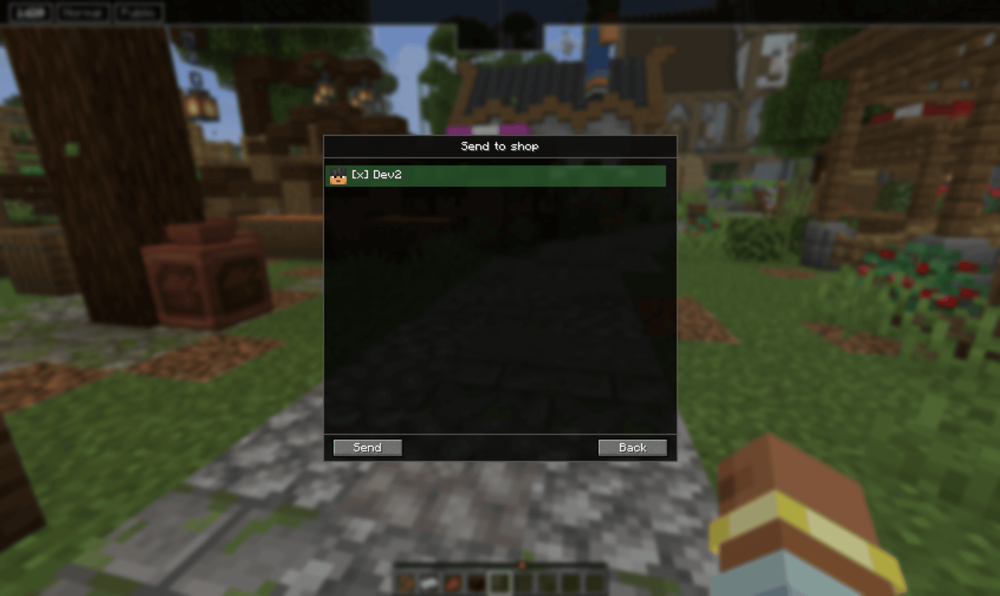

Players who are sent arrive spread around the spawn point, so they do not land on top of
each other. Session players who are not in the world yet are brought in.

### Staying inside

A player who has been sent to a moment stays in its area. Walking towards the edge tints
the screen, and stepping past it pulls them back. Ghosts are held in too. The GM is never
held.

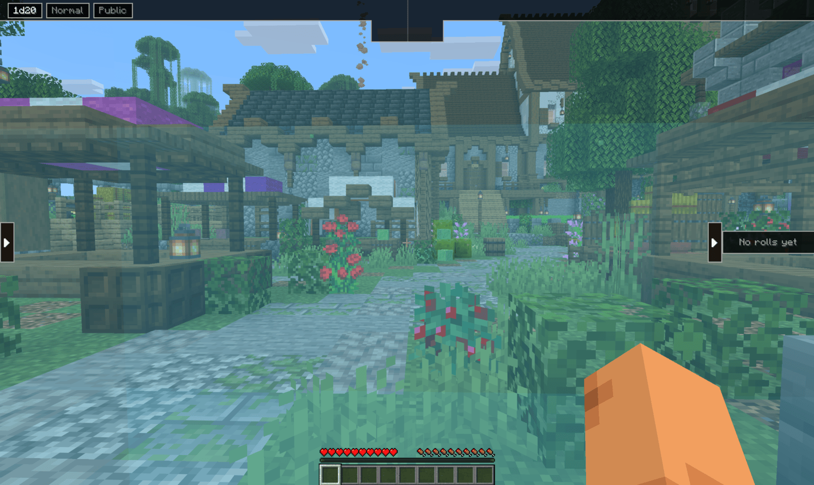

## The spotlight and split parties

The spotlight is where the story is happening right now. Spotlighting a moment shows a
**Meanwhile…** card to everyone in the campaign, with the moment's name underneath.

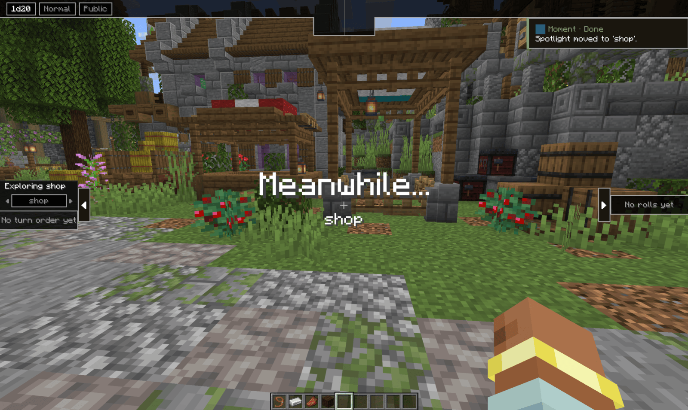

Players who are bound to a different moment do not just wait. They become watching ghosts
in the spotlit moment, with **Spectating** on their HUD, so they follow the other group's
scene. When the spotlight comes back to their own moment, they are put back in their body
where they left it.

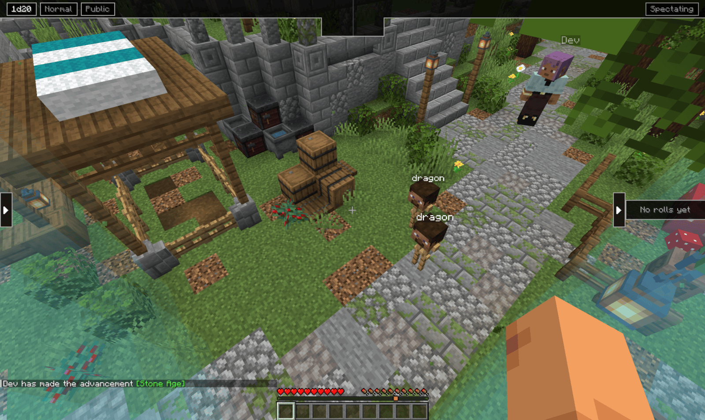

### Cutting between moments

With two or more moments active, the turn order panel gets a moment selector in its header,
even outside turn mode.
The arrows step through the active moments, each with its own turn order, so you can check
on a group without moving the spotlight. The header then reads **Move to …**, and clicking
the name cuts the spotlight there.

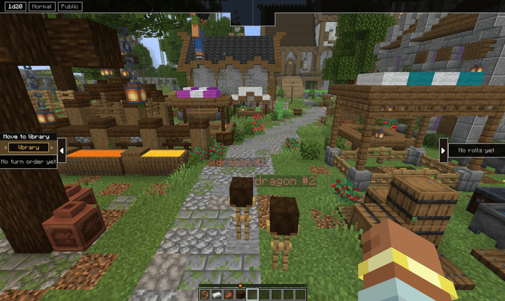

Each moment keeps its own turn order and round count, so one group can be mid-combat while
the other explores. See [Turns and combat](../turns/).

## From the wheel

Inside the world, hold `G` and go to **World**. Your moments and folders are listed around
the wheel, with **Regroup players** (into the spotlit moment) and **World Panel**.

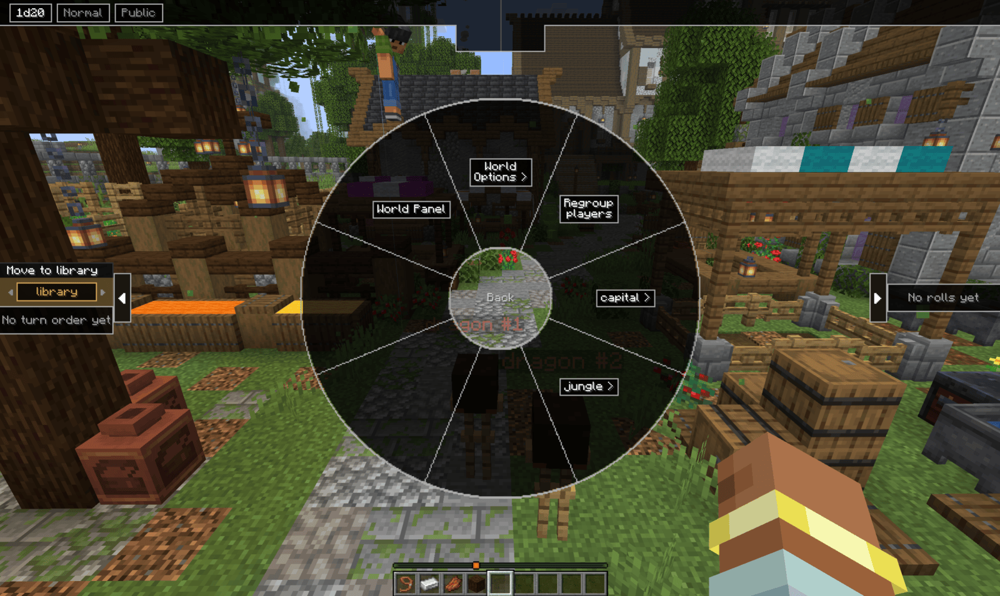

Pick a moment for its play actions (send, regroup, go, spotlight, activate) and its area,
plus **Open in Panel**. Renaming, moving and deleting stay on the Moments page.

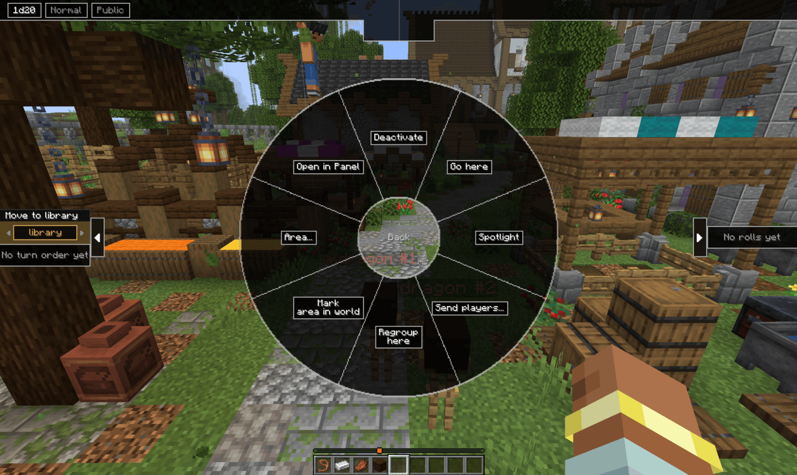

## On the map

The World tab's map draws every moment with an area as a labelled box, and shows where
players are. Click a box for that moment's menu.

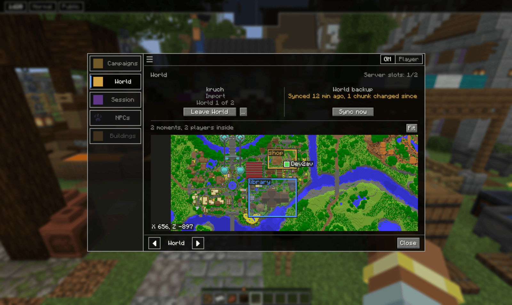

Full syntax for the moment commands: [Command reference](../commands/#moments)

[Back to the manual index](../)
