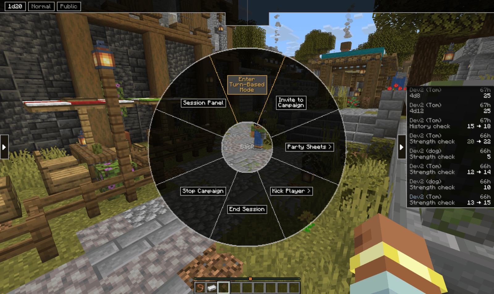
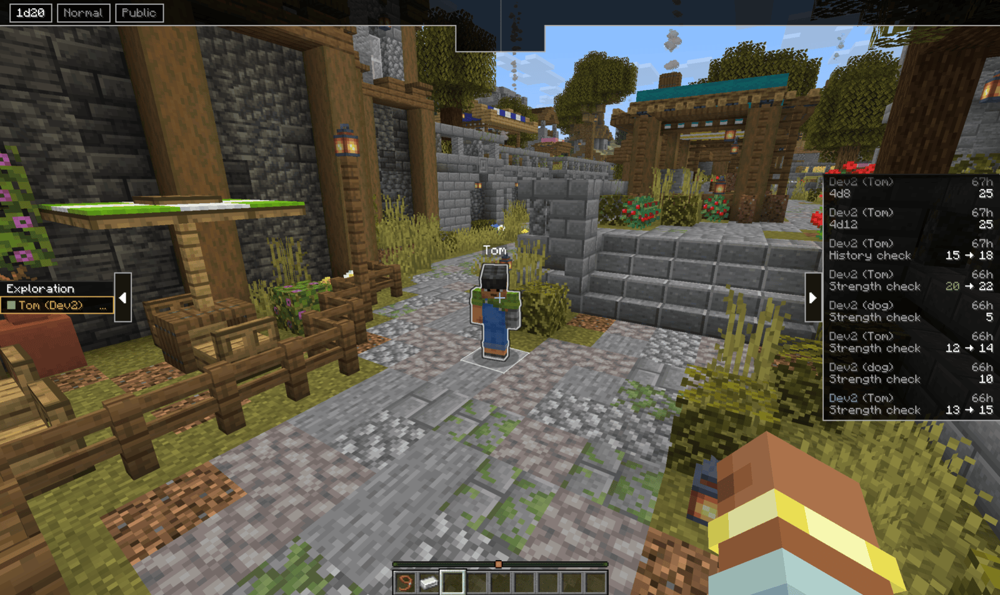
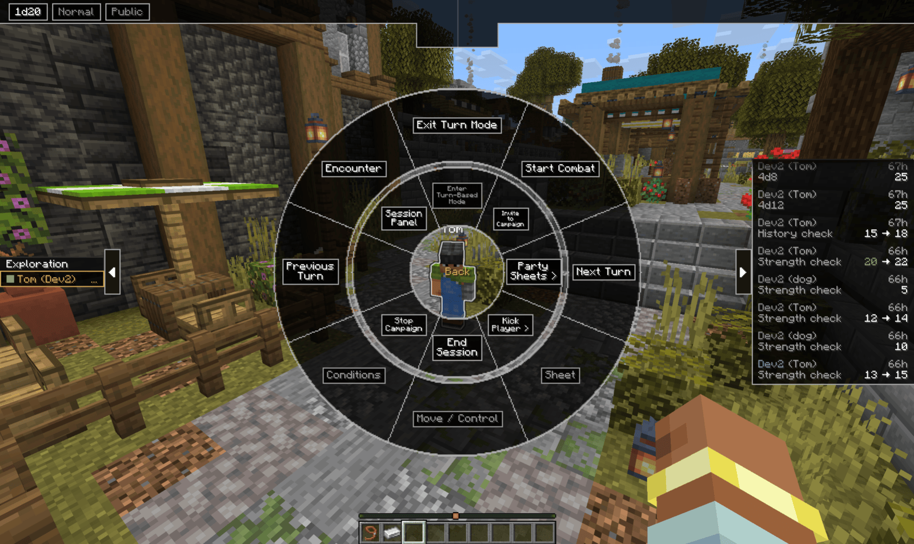
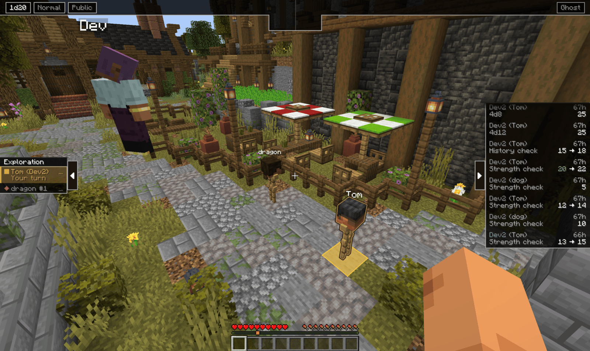
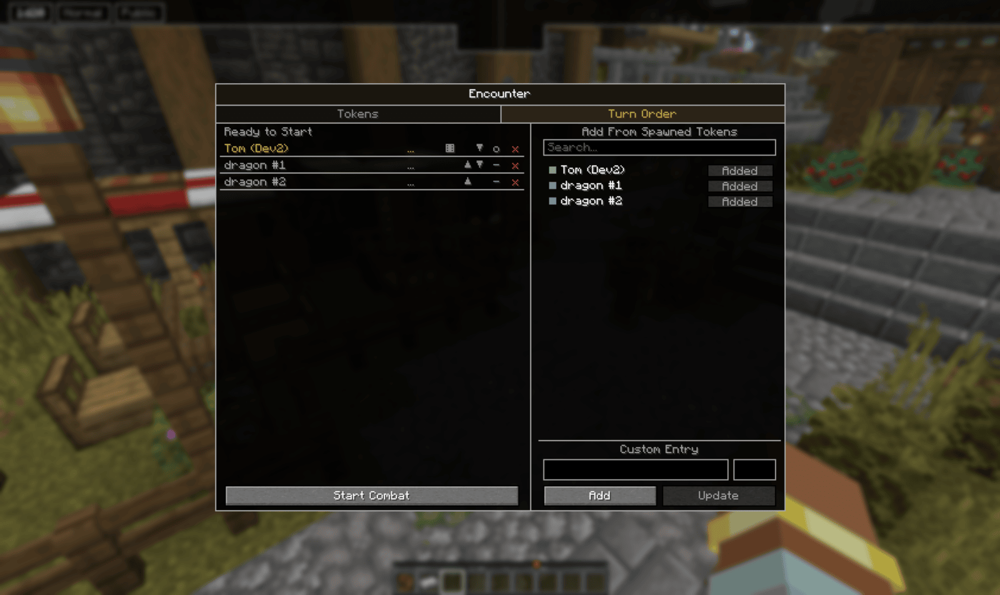
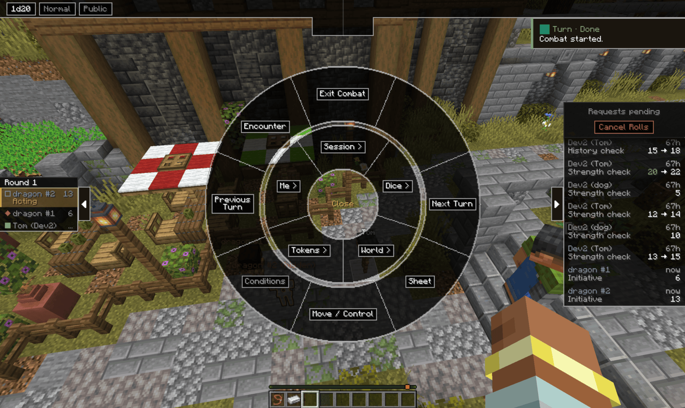
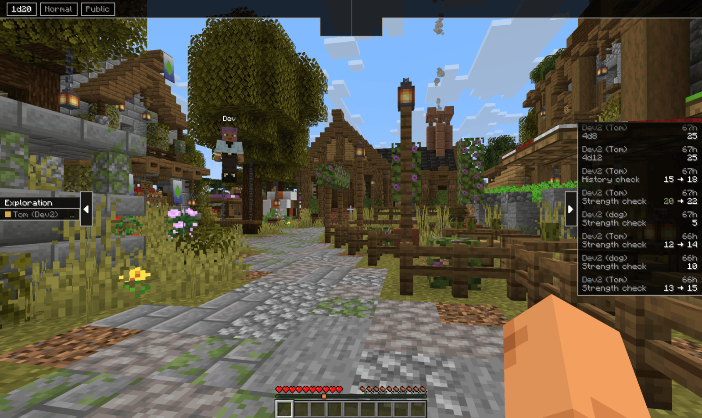

# Turns and combat

A campaign runs in one of three modes.

- **Exploration**: normal Minecraft. Everyone moves freely and acts whenever they want.
- **Turn mode**: everyone freezes on the spot, and only the player whose turn it is can
  move. No initiative, no rounds, the GM just passes the turn around.
- **Combat**: turn mode plus an initiative order and a round counter.

## Turn mode

Hold `G`, go to **Session**, and pick **Enter Turn-Based Mode**.

The moment it lands, every player in the world snaps to the block they are standing on.
That block is their anchor, and it stays highlighted so the table can see where each
body is. The turn order panel opens on the left edge with the header **Exploration** and
one row per player, each showing `...` where an initiative would go.

**Nobody rolls anything yet.** Plain turn mode has no initiative and no rounds. It is for
"you go, then you go" moments outside a fight: sneaking through a manor, a tense
negotiation, anywhere you want people to act one at a time.

### Frozen

While it is not your turn, you cannot walk. Your movement keys do nothing, and if
anything pushes you off your anchor the server pulls you back. You can still look around,
open your sheet and roll. When your turn comes, the freeze lifts and you can move
freely. Wherever you stop when your turn ends becomes your new anchor.

### Passing the turn

The GM's wheel grows a second ring around the session one while turn mode is on.

- **Next Turn** and **Previous Turn** step through the order
- **Start Combat** is covered below
- **Sheet** opens the sheet of whoever is acting, **Move / Control** the token menu for
  them
- **Encounter** opens the encounter screen
- **Exit Turn Mode** releases everyone
- **Conditions** is not built yet

A player can end their own turn from their wheel, which offers **End Turn** while it is
their turn. The command is `/voxelroll turn end`.

### Ghost mode

Frozen does not have to mean stuck. Press `H` (or **Leave Body** on your wheel) to leave
your body where it stands and fly around as a ghost. You can look at anything, but you
pass through nothing, walls still stop you.

Your body stays on its anchor with a stronger highlight, and a **Ghost** chip shows on
your HUD bar. Press `H` again to return. If the order steps to your turn while you are
out, you are pulled back into your body automatically.

## Combat

Combat needs a turn order with numbers in it. Two ways to fill them.

**Ask the table.** Hold `G`, **Dice**, **Roll Initiative**. Every player in the session
gets an initiative request on their roll panel. See [Dice and rolling](../dice/) for how
requests work. Anyone who has not answered by the time combat starts is asked again.

**Add monsters and NPCs.** Open **Encounter** and switch to the **Turn Order** tab.

The right side lists every spawned token. **+ Add** puts one in the order. Or type a name
and a number under **Custom Entry** for something that has no token. Click a row to load
it into those fields and **Update** it. Each row also has its own controls: the dice icon
rolls initiative for that entry right now, the arrows swap entries that are tied on
initiative, `o` / `-` reveals or hides the entry to players, and the cross removes it.
Monsters roll their own initiative when combat starts, so leave their number as `...`
unless you want to set it.

**Monster and NPC entries start hidden.** Players see nothing of them until you reveal
them.

### Start Combat

From the GM's turn ring or the bottom of the Turn Order tab. The order sorts by initiative,
highest first, the header changes to **Round 1**, and the first entry is up.

From here it is Next Turn, End Turn, Next Turn. When the last entry ends its turn, the
round counter ticks up and the order starts over.

**Exit Combat** drops the rounds but keeps you in turn mode with the order intact, so a
second fight in the same room starts from where you are. **Exit Turn Mode** clears
everything and releases the freeze.

## Reading the panel

The left panel is the same on every screen, filtered per player.

- **Header**: **Exploration** outside combat, **Round N** inside it
- **Gold row**: whoever is acting.
- **`...`** in place of a number: this entry has not rolled initiative yet
- **Marker colour**: gold is you, green is another player, a red diamond is a monster or
  NPC, a blue outline is an entry only the GM can see

When a hidden entry is acting, players see no gold row at all. The order just pauses from
their point of view.

Aim at a token in the world and its row outlines gold. Hover a row and its token pings in
the world.

## Moments

With moments set up, each moment runs its own turn order and the panel header names the
moment you are in. See [Moments](../moments/).

Full syntax for the turn commands: [Command reference](../commands/#turns-and-combat)

[Back to the manual index](../)
