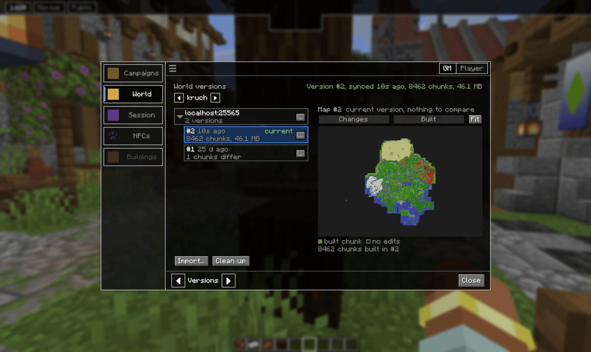
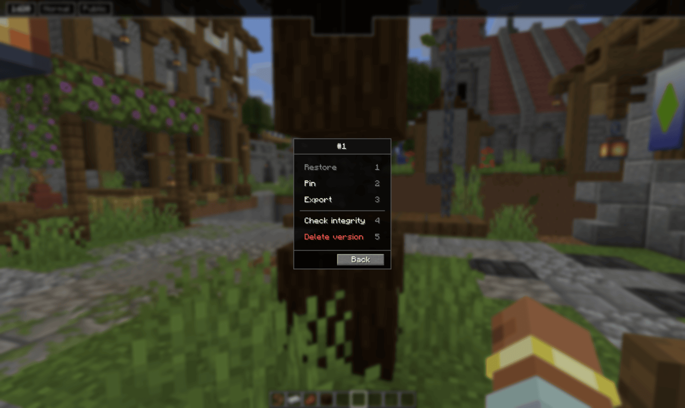
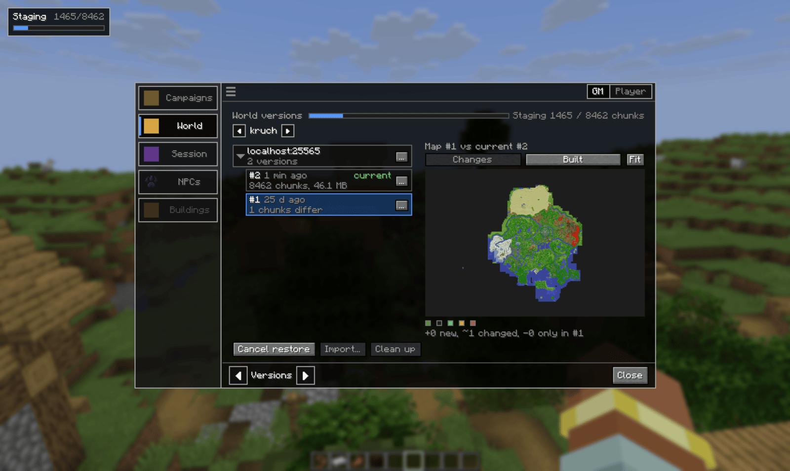
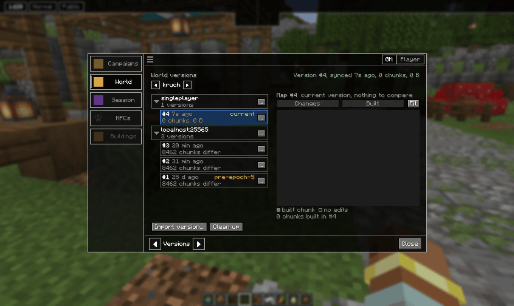
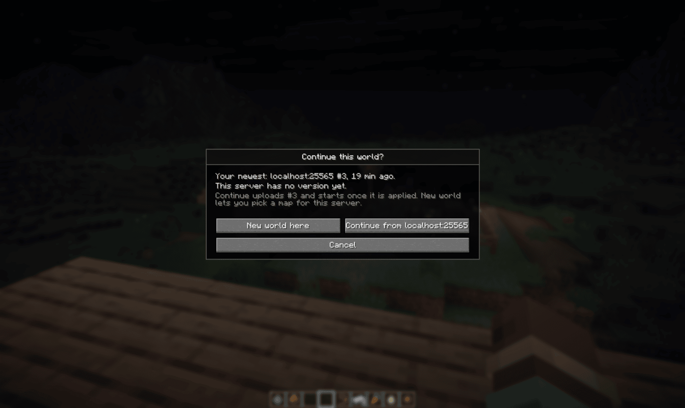
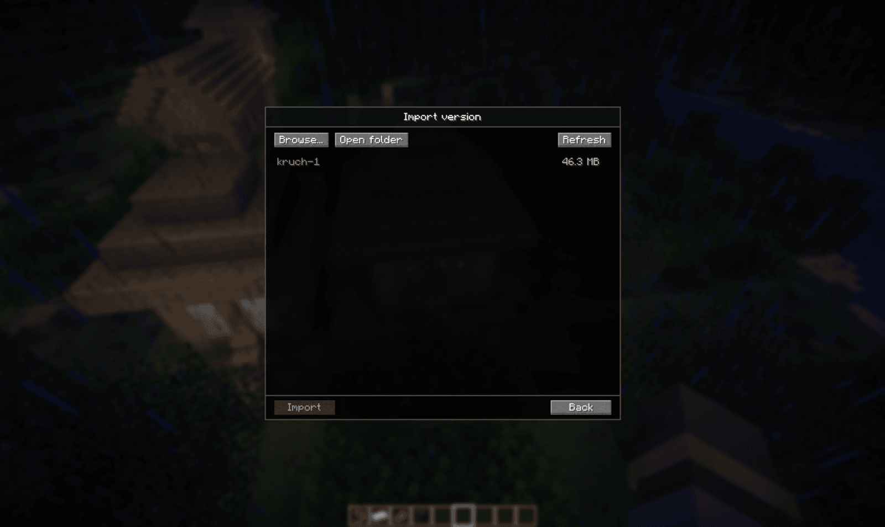

# World versions

Your machine keeps a copy of every campaign world. Each time you sync, the changes made on
the server since the last sync are saved as a new **version**. You can go back to any of
them, pin the ones that matter, export them as files, and carry a world to another server.

## Syncing

The **World backup** line on the World tab says how up to date your copy is: when you last
synced, and how many chunks have changed on the server since. **Sync now** pulls those
changes in and saves them as a new version.

You also sync without asking:

- when you stop the campaign from the Campaigns tab, it pulls the latest changes first, then
  stops
- before a restore, if your copy is behind, you are asked to sync first

## The Versions page

On the World tab, use the arrows at the bottom to switch to **Versions**. The arrows next to
the world's name at the top switch between the campaign's worlds.

Versions are grouped by the server they were synced from. The version your copy is on now is
marked **current**. Every other row says how many chunks differ from it.

Click a version to see it on the map:

- **Changes** colours what differs between that version and the current one: new chunks,
  changed chunks, and chunks that only exist in the older version
- **Built** shows every chunk the version holds
- **Fit** resets the zoom

## A version's menu

Each version's **…** opens its actions.

- **Restore** puts this version back on the server. See below.
- **Pin** gives the version a name and keeps it forever. Up to 10 pins per campaign.
  Pinned versions show the pin's name and get **Unpin** and **Rename** instead.
- **Export** saves the version as a `.vrw` file in `.minecraft/voxelroll/gm/exports`.
- **Check integrity** verifies every chunk. A version with broken chunks is marked
  **damaged**, and you are offered to repair it by downloading the world from the server
  again.
- **Delete version** removes it. Not possible for the current version or a pinned one.

## Restoring

Restore replaces the server's world with the chosen version. It only works while the world is
not loaded on the server, so free its server slot first (see [Worlds](../worlds/)).
Otherwise **Restore** is greyed out.

Before anything happens, a confirm popup says which version will be uploaded and how many
chunks changed on the server since then. Those changes are overwritten. The server archives
its own copy first, so a server operator can still undo it.

Moments, player positions and the roster are not touched.

Once confirmed, the version is uploaded and applied. A progress bar shows in the top left of
the screen and on the Versions page, going through **Uploading**, **Staging** and
**Applying**. **Cancel restore** stops it before it is applied.

## Server lines

Each server you have played a world on gets its own group in the list. Your
own singleplayer worlds show up as **singleplayer**.

Each group's **…** lets you rename it, so `localhost:25565` can become "Home server", or delete
every version in it.

Some pins are made for you, such as `pre-epoch-5` above. Before the server's world is
regenerated or replaced, the version you had is pinned automatically so it cannot be lost.

## Moving a world to another server

When you enter a world on a server that has an older version than yours, or none at all,
you are asked what to do.

- **Continue from …** uploads your newest version to this server. The campaign starts once
  it is applied.
- **Keep this server's world** uses what the server already has. Both versions stay in your
  list. Only offered when the server has one.
- **New world here** lets you pick a different map for this server.

## Importing a .vrw file

**Import version…** at the bottom of the Versions page adds an exported `.vrw` file as a new
version.

It lists the files in your exports folder. **Browse…** picks one from anywhere else, **Open
folder** opens the exports folder, **Refresh** rescans it after you drop a file in.

## Cleaning up

**Clean up** frees disk space. It keeps your recent versions and thins out the older ones,
down to one per hour, then one per day. Pinned versions are never removed.

Full syntax for the version commands: [Command reference](../commands/#world-versions-and-backups)

[Back to the manual index](../)
