# Worlds

A campaign world is a separate Minecraft world that belongs to one campaign. The party plays
in it and the GM builds in it, apart from the server's normal world, so nothing done in a
session spills over. Because it is also kept on the GM's machine, it can move to another
server along with the campaign.

A campaign can hold up to three worlds, with one of them active at a time. Everything on
this page is the GM's side. Players have no World tab: they arrive in the world when they
join the session, and leave it when they leave the session.

## The World tab

Open the panel with `C`, switch to GM, and pick **World**. The tab appears once a campaign
is running.

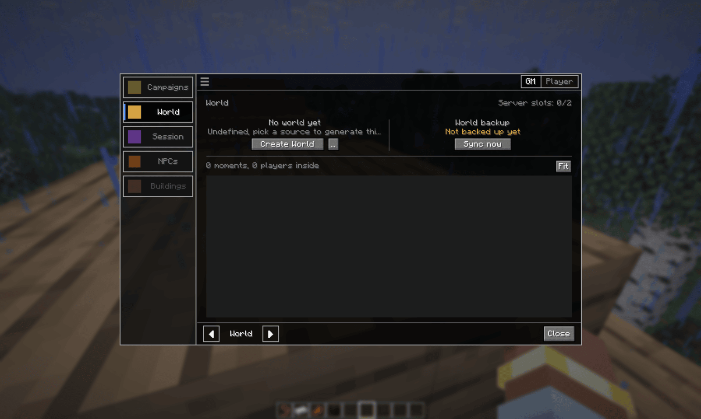

- **Server slots** in the top right is how many campaign worlds this server can have loaded
  at once, and how many are in use. A loaded world takes a slot, an archived one does not.
- **World backup** on the right is the copy of the world kept on your own machine. See
  [World versions](../world-versions/).
- The empty area below is the map. It fills in once the world has terrain.

## Creating a world

**Create World** opens the source picker.

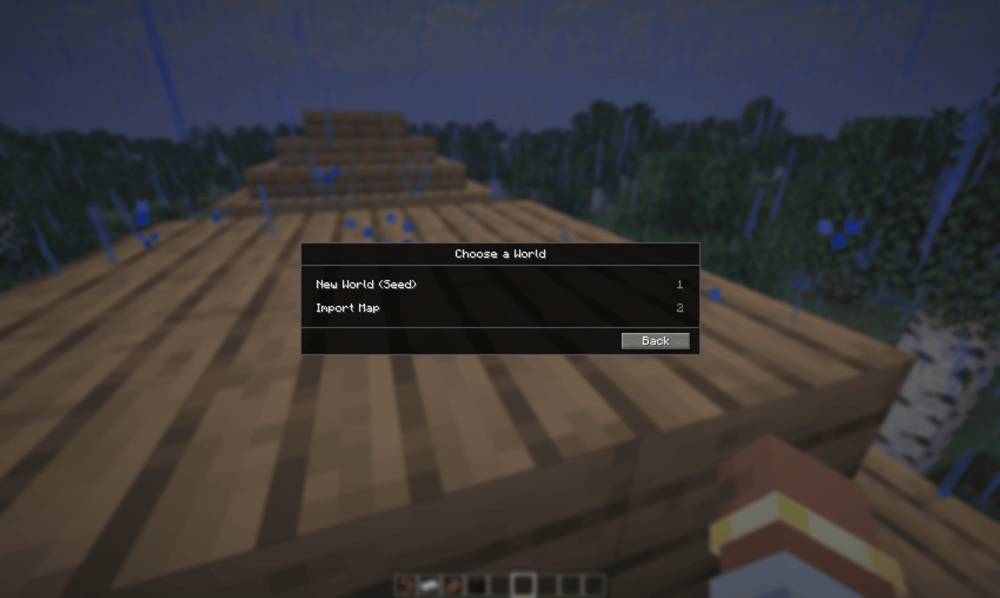

### New World (Seed)

A normal Minecraft world from a seed. Type one, or leave the field blank for a random seed,
then **Create**.

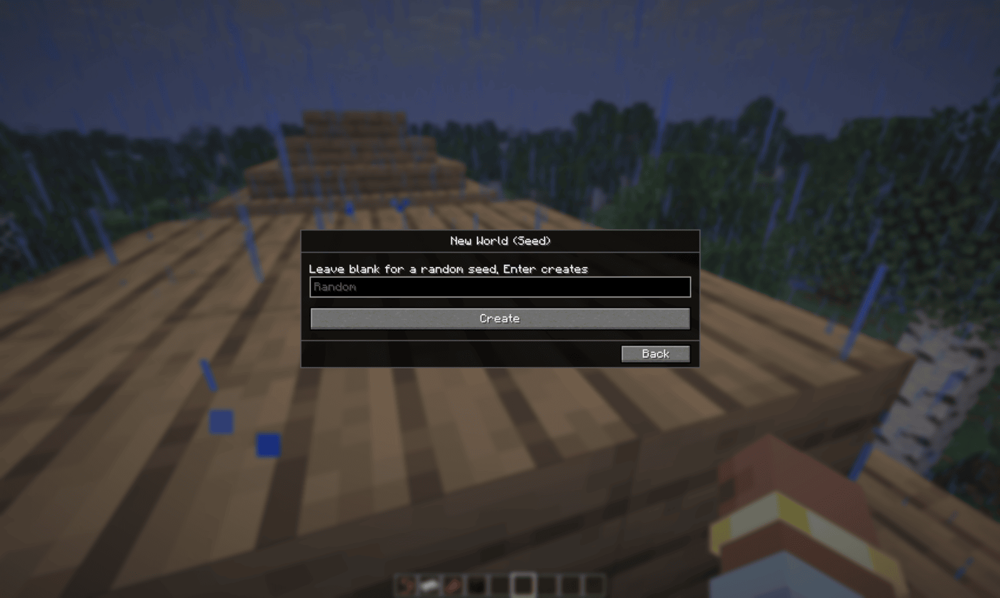

### Import Map

Build the world from something you already have. Import Map only works while you are in a
world, singleplayer or a server, because the import needs the game's block list to read the
map.

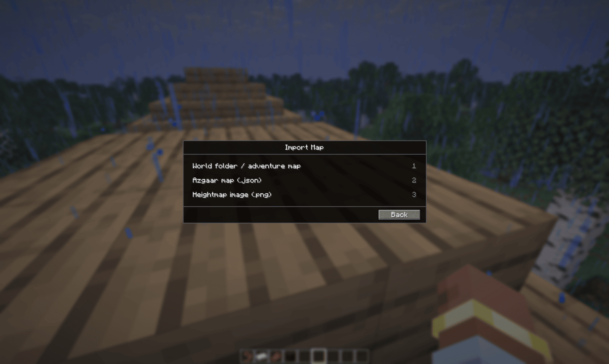

**World folder / adventure map** takes an existing Minecraft save, such as a downloaded
adventure map or one of your own singleplayer worlds. Pick the save folder and the mod scans
it first.

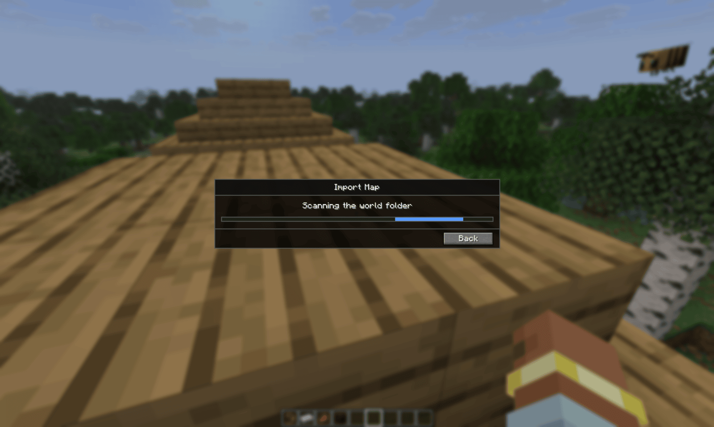

The import popup then shows what it found and lets you cut out the part you want.

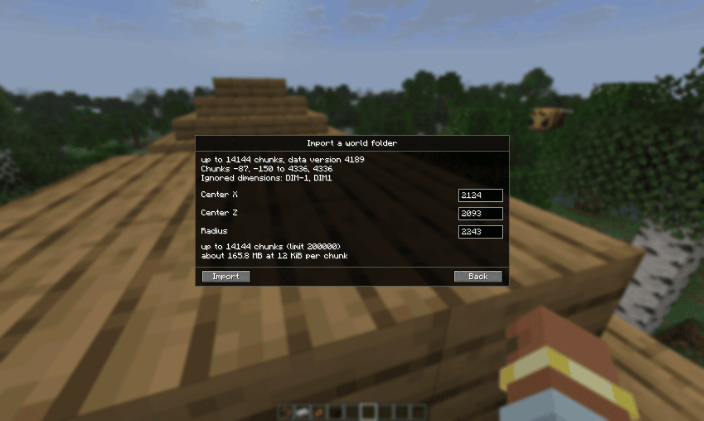

- The top lines give the size of the save, its Minecraft data version, and which
  dimensions are skipped. Only the Overworld is imported, the Nether and the End are not.
- **Center X**, **Center Z** and **Radius** pick the area to import, in blocks. They start
  out covering the whole save.
- The bottom lines estimate the size. An import is capped at 200,000 chunks. Crop smaller if
  you are over.

On some systems there is no folder picker window. You then get a plain text box instead:
paste the full path to the save folder and press **Import**.

**Azgaar map (.json)** turns a map exported from Azgaar's Fantasy Map Generator into terrain.

### While it imports

The import runs on your own machine, and you can keep playing while it does. A progress
box in the top left of the screen counts the chunks. When it finishes, a toast says how
many chunks came in and, if the campaign is running, the world is uploaded to the server.

## Entering and leaving

Players enter the world automatically when they join the session. The GM enters with
**Enter World** on the World tab, or:

```
/voxelroll world enter
```

Everyone who arrives gets a title card with the world's name.

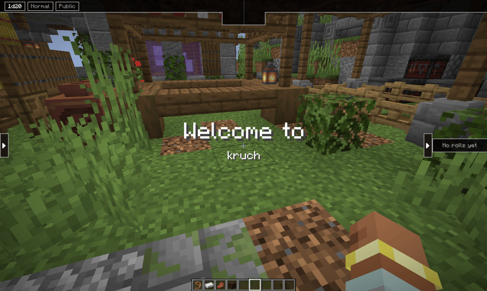

Inside, players are in adventure mode, so they cannot break or place blocks. The GM is in
creative mode.

**Leave World** on the World tab, or `/voxelroll world leave`, puts you back exactly where
you were before entering, with your game mode restored. Players are also sent back when they
leave the session or the campaign ends.

## The dashboard

Once the world exists, the World tab shows its name and how it was made. With more than one
world it also says which one is active ("World 1 of 2"). Next to it are the **…** menu and
the backup line with **Sync now**.

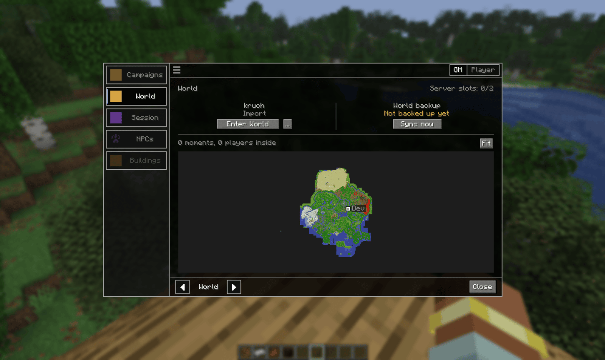

The map shows the world from above. Moments appear as outlined areas you can click, and
players show as markers. A player who has left shows where they were last seen and how long
ago. **Fit** resets the zoom.

**…** holds **Worlds…** and **Free server slot**.

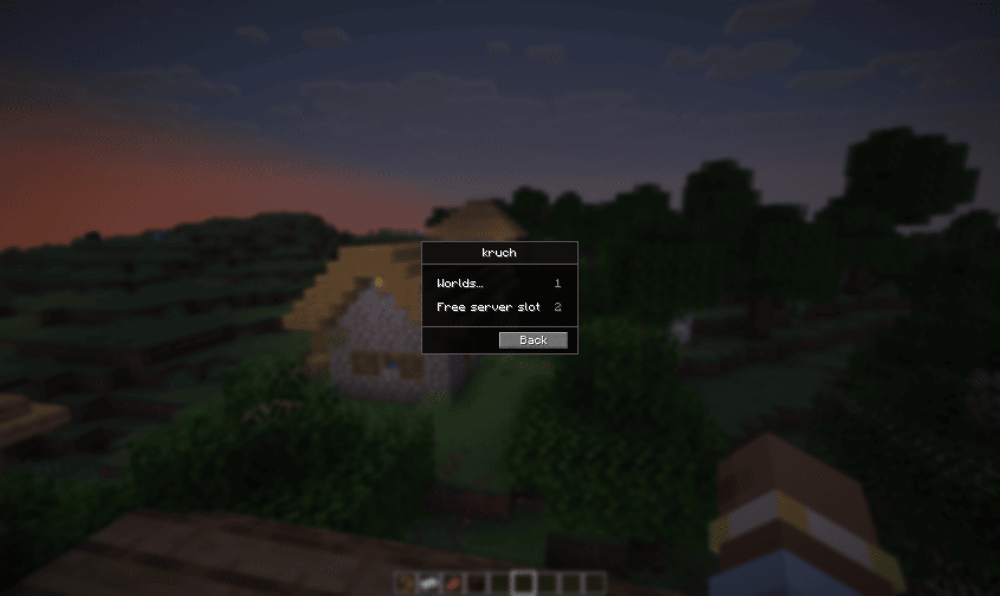

### More than one world

**Worlds…** lists every world in the campaign. **Active** marks the one in use, **On server**
marks each world the server holds a copy of. **New world** adds one, up to three per
campaign.

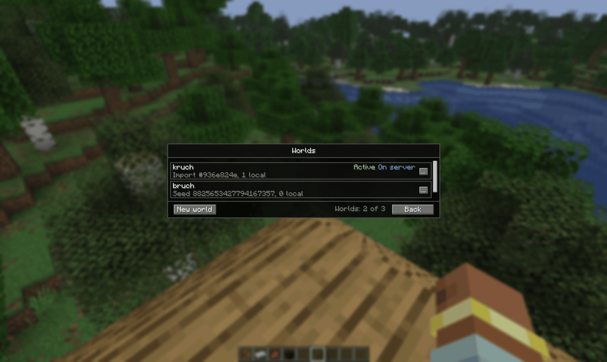

Each row's **…** has the actions for that world:

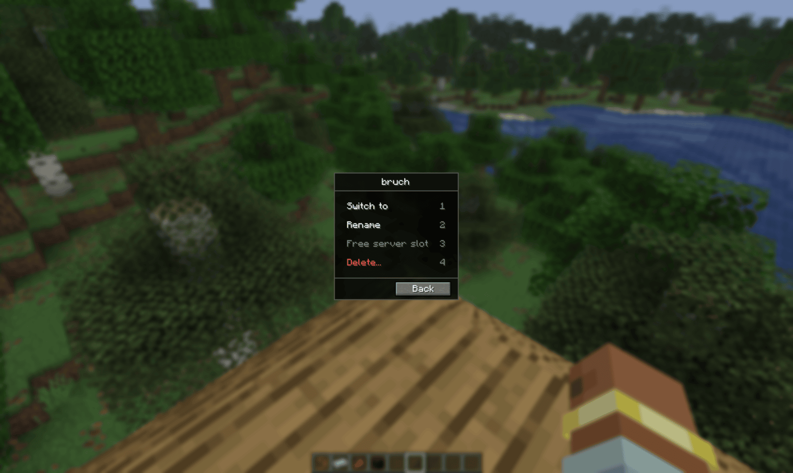

- **Switch to** makes it the active world. Free the current world's slot first.
- **Rename** changes its name.
- **Free server slot** frees that world's slot, see below.
- **Delete…** opens the delete options.

### Deleting

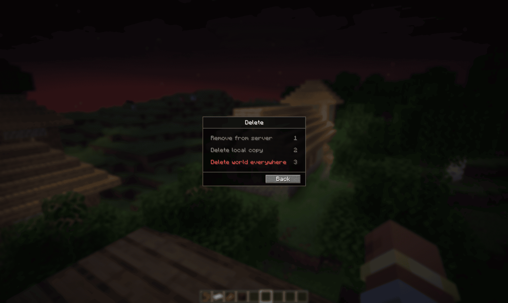

- **Remove from server** deletes the server's copy. Your files and the world entry stay.
- **Delete local copy** deletes the files on your machine. Any server copy stays.
- **Delete world everywhere** removes both and takes the world out of the campaign. Not
  possible for the campaign's last world.

An option is greyed out when there is nothing for it to delete, or the world is in use.

## Freeing the server slot

A world only holds a server slot while it is needed. Freeing the slot archives the world on
the server. Nothing is lost: the next time someone enters, it comes back as it was.

The slot is freed:

- when the world has been empty for 10 minutes
- when the campaign stops
- when the server shuts down
- by hand, with **Free server slot** on the **…** menu or the World wheel. Anyone still
  inside is sent back to where they came from, and you are asked to confirm first.

If every slot is in use, another world cannot load until one is freed.

## Time and weather

Inside the world, hold `G` and go to **World**, then **Options**.


**Time** jumps to day, noon, night or midnight, or freezes and resumes the clock.

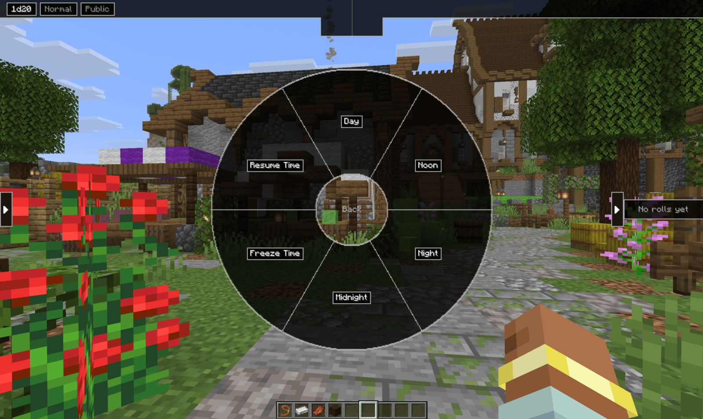

**Weather** sets clear, rain or thunder.


Both only affect the campaign world.

Full syntax for the world commands: [Command reference](../commands/#worlds)

[Back to the manual index](../)
